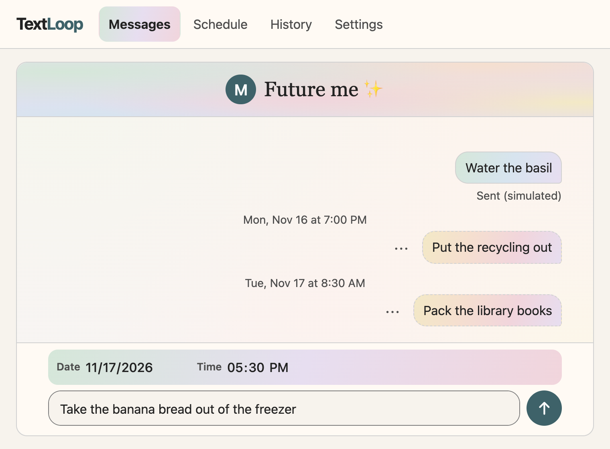
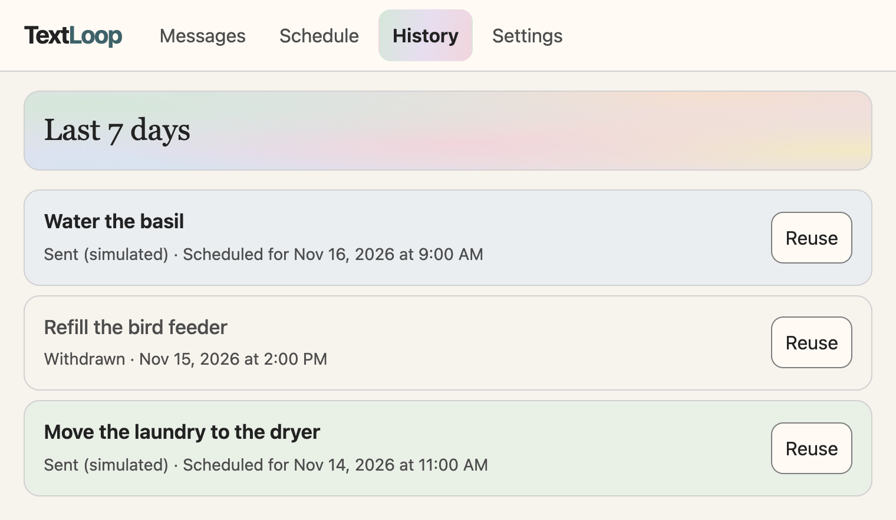
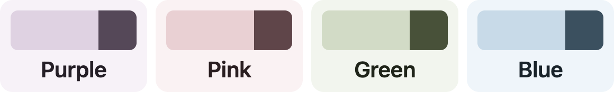

<h1 align="center">TextLoop</h1>

<strong>Schedule a text to your future self.</strong> 
Get the reminder and carry on. No checkbox or reply required.

Local preview · Simulated SMS 
Runs locally without authentication or real SMS. 
<a href="docs/local-setup.md">Run it locally</a> ·
<a href="docs/api-guide.md">API guide</a>

## Why I made it

Do you ever set a reminder on your phone only for it to show up along with all the
rest of your notifications, then you just clear all your notifications and ignore it?
Even if I make it repeat daily for a month, I will likely ignore it the entire time.

Whether this is because of my ADHD or not, I'm not sure. You know what I don't ignore
though? Texts. What I love is when I have an appointment and the business sends me a
text reminder. Then I can leave it unread for days, but I'm constantly wondering what
that notification is so I keep checking it, and I never forget it.

At some point, I even started asking friends to use the `Send Later` iMessage feature
for reminders, which is where this idea came from. Bottom line: I'm far more likely
to consider a text than a traditional notification.

## How I designed it

I wanted TextLoop to do one thing and feel easy to use with ADHD. When I think
of something I need to remember, I want to get it out of my head while it’s
still there.

- **Open it and start typing.** TextLoop opens straight to Messages. The date
  and time are already set to tomorrow at 9 AM, so if that works, I can just
  type the reminder and tap the arrow.
- **Keep the controls familiar.** Creating, editing, and reusing a reminder
  all use the same message box with the date and time right above it. Edit and
  Reuse open it over the tab I’m already on, so I always know where to look.
- **Make it easy to try again.** I can check **Schedule** for what’s coming up
  or withdraw a reminder if I change my mind. If I miss one, **History** shows
  the last seven days of sent and withdrawn reminders. **Reuse** fills in the
  old message, and I pick a fresh time.

### A little color

The fun part of building this for my own ADHD brain was picking the colors.
The pastel **Colorful** theme in these screenshots is my favorite. You can
pick your own color and switch between light and dark mode in **Settings**.

## How it works

TextLoop uses Java 25 and Spring Boot, PostgreSQL for storage, and a plain
JavaScript frontend. A scheduler checks for due reminders every minute and
submits them to a simulated SMS sender.

TextLoop keeps the reminder and its send attempt separate. If the outcome is
unknown, it holds the attempt for review so an automatic retry doesn’t risk a
second text. If the sender’s acceptance was already recorded, TextLoop can
finish updating the reminder without submitting it again.

## Setup and tests

The [local setup guide](docs/local-setup.md) walks through Java 25, PostgreSQL,
and scheduling a first reminder. Run the tests with `mise exec -- ./mvnw verify`
while Docker is running. GitHub Actions runs the same tests. See the
[delivery recovery guide](docs/delivery-recovery.md) for recovery commands.

## Snooze by reply

I wanted a quick way to say “give me a little longer.” You can change the
default snooze duration in Settings and [simulate a `SNOOZE` reply](docs/api-guide.md#simulate-an-inbound-reply)
to your latest reminder.
